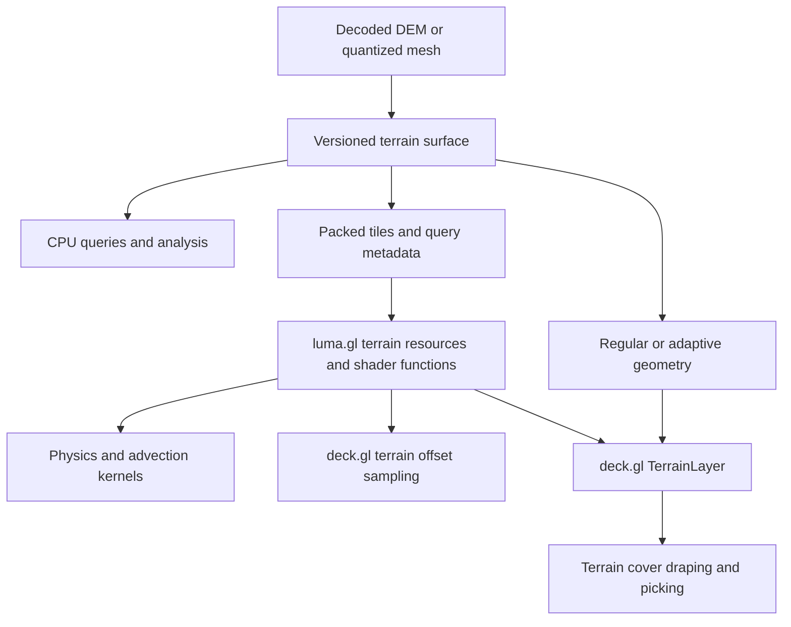

{/* SPDX-License-Identifier: MIT */}
{/* SPDX-FileCopyrightText: Copyright (c) vis.gl contributors */}

# Terrain math and GPU compute roadmap

Status: proposal, researched October 26, 2026. Phase numbers express dependencies,
not release dates or staffing commitments. APIs below are design sketches. This is
a cross-repository roadmap: shader code and device execution belong in luma.gl,
not math.gl.

## Implementation progress

October 26, 2026: the first local Cartesian foundation is implemented in
[`@math.gl/geospatial/terrain`](../modules/geospatial/terrain/README.md), with a dependency-free runtime
sampling entry and optional `@math.gl/geospatial/terrain/geometry` mesh entry. The opt-in subpath follows master's six-package consolidation while keeping
height-field sampling independent of the geospatial root and its runtime imports.
Optional geographic and tiled adapters extend this contract without adding root imports.

Delivered: copied/normalized affine grids, vertex/cell registration, validity and
height-reference metadata, scalar/batch nearest/bilinear/triangle sampling,
metric interpolant gradients and normals, extrema, regular meshes with explicit
origins, and analytic/mesh conformance tests. See the
[API contract](../docs/modules/geospatial/terrain/README.md).

The geographic/tiled tranche adds geographic/Web Mercator raster queries with WGS84 metric
derivatives, immutable cell-registered tiled snapshots, neighbor halos, explicit
residency, whole-footprint coarser fallback, and transferable halo copies.

Incremental snapshots now support atomic insertion, replacement and eviction with
neighbor-halo invalidation. The opt-in packed-buffer entry adds an experimental
versioned f32/u32 upload layout, byte/height-error budgets and validated CPU
reconstruction. This is a renderer-independent data substrate. Shader code and
device execution belong to companion luma.gl work.

Indexed terrain surfaces now provide barycentric sampling, edge topology and
BVH-backed ray/segment/nearest queries. Conservative cell min/max hierarchies
retain extrema and source-coverage counts, with exhaustive CPU references.

Bounded BVH ray/segment/nearest queries now return explicit completion status and
work counts. Discrete sphere contacts use triangle faces, edges and vertices with
separate contact and face normals, mask filtering, and contact-capacity limits.
Incomplete results cannot be interpreted as misses. This advances T5; reduced
manifolds, capsule contacts, swept queries and solver integration remain open.

This is partial T0/T1/T2/T3/T5 delivery. Independent real-DEM fixtures, a CPU/GPU/deck.gl
spike, vertex-tile reconciliation, persistent cache structures, adaptive meshes,
and GPU qualification remain open. The remaining sections describe the target architecture and delivery gates.

## Recommendation

Build `@math.gl/geospatial/terrain` as an opt-in, renderer-independent terrain mathematics entry:
height fields and triangulated surfaces, explicit geospatial semantics, tiled
sampling, derivatives, mesh generation, and accelerated queries. Make its packed
data and numerical contracts usable by device-callable shader functions and GPU
command graphs in luma.gl. Treat deck.gl's `TerrainLayer`, terrain offsetting,
draping, and picking as first-class consumers alongside physics and advection.

The distinguishing capability should be **consistent terrain answers across CPU
queries, GPU simulation, and rendering, with explicit approximation and coverage**.
A sophisticated tessellator alone does not provide this. Different consumers need
different representations and resolutions, with a traceable relationship between
them.

Use two complementary representations:

- **Height fields:** efficient sampling, stencil operations, regular GPU memory
  access, raster analysis, and fixed-topology rendering.
- **Triangulated terrain:** compact adaptive geometry, quantized-mesh input,
  breaklines, barycentric queries, and collision/intersection surfaces.

Both describe a surface over a declared horizontal domain. Overhangs, caves,
buildings, and multiple elevations at one horizontal position require a separate
general mesh or volume capability. Reserve integration points for those without
making a height query ambiguously choose between surfaces.

## Existing vis.gl foundation

This assessment inspected sibling working copies as well as public documentation.
Repository snapshots identify the inspected baseline, not an assertion that all
features are published. Code takes precedence over older roadmap status tables.

| Repository | Inspected HEAD | Relevant evidence |
| --- | --- | --- |
| deck.gl | `6c5fbb36a6e089abba1f5259b2f1fff72bfbf153` | `modules/geo-layers/src/terrain-layer/terrain-layer.ts`; `modules/extensions/src/terrain/{terrain-extension,terrain-effect,height-map-builder,terrain-cover,shader-module}.ts` |
| loaders.gl | `2a9a5ef3094c972617f8208c8cda41c5b24507c0` | `modules/terrain/src/lib/{parse-terrain,parse-quantized-mesh}.ts` |
| luma.gl | `23eb0f713e1f66dc8cf6c9b73aefbd740309de92` | `modules/experimental/src/simulation/{flow-particle-field,flow-field-atlas,flow-particle-simulation}.ts`; `modules/experimental/src/gpu-project/`; `modules/gpgpu/src/gpu-core/gpu-command-graph.ts` |
| MapLibre GL JS | `021ebb2f13179d7acf6fb19a69eeffb3b2246f61` | `src/data/dem_data.ts`; `src/render/terrain.ts` |

math.gl already supplies [typed geometry](../modules/geometry/src/lib/geometry.ts),
[ellipsoid transformations](../modules/geospatial/src/ellipsoid.ts),
[projection](../modules/geospatial/projection/README.md),
[Web Mercator utilities](../modules/web-mercator/src/), and
[geoid conversion](../modules/earth/geoid/README.md). Reuse these foundations. In
particular, existing `PlaneGeometry` is Y-up; a geographic east/north/up terrain
frame is Z-up. An adapter must express that distinction.

loaders.gl's [TerrainLoader](https://loaders.gl/docs/modules/terrain/api-reference/terrain-loader)
already decodes elevation images and produces adaptive meshes. Its inspected
implementation uses MARTINI or Delatin; its MARTINI path duplicates outer samples
to complete a grid. This is useful compatibility behavior but does not establish
cross-tile derivative continuity. Preserve raw decoded heights and registration
metadata so downstream consumers do not need to reconstruct them from a mesh.
The [quantized-mesh loader](https://loaders.gl/docs/modules/terrain/api-reference/quantized-mesh-loader)
provides a second input path that should preserve original connectivity.

The inspected luma.gl flow field uses a borrowed `rgba32float` texture containing
east/north velocities and validity, explicit units, and endpoint grid samples.
Its `FlowFieldAtlas` supports incremental tile uploads without replacing particle
state. Those ownership and validity conventions are a useful integration target;
they are not yet a multiresolution terrain interface. The existing GPU projection
design also distinguishes inline shader evaluation from graph materialization.
Reuse that execution pattern while respecting its documented supported domains.

## Open-source precedents and what to adopt

The adoption column contains design recommendations, rather than claims that any
one project already provides the complete proposed system.

| Effort | Observed capability | Adoption decision |
| --- | --- | --- |
| [CesiumJS TerrainData](https://cesium.com/learn/cesiumjs/ref-doc/TerrainData.html) and [quantized-mesh](https://github.com/CesiumGS/quantized-mesh) | Tile interfaces support height interpolation, child availability, and upsampling. The mesh format preserves tile-local coordinates, height ranges, and boundary indices. | Preserve availability, parent provenance, mesh topology, and boundary metadata. Make dataset queries independent of the active rendered tiles. Avoid treating upsampled detail as new source information. |
| [MapLibre DEMData](https://github.com/maplibre/maplibre-gl-js/blob/021ebb2f13179d7acf6fb19a69eeffb3b2246f61/src/data/dem_data.ts) | Bilinear sampling, extrema, and padded borders that are replaced with neighboring data when available. | Adopt explicit halos and neighbor-driven invalidation. Distinguish provisional edge replication from complete neighborhood data. |
| [MARTINI](https://github.com/mapbox/martini) | RTIN hierarchy for square `(2^k + 1)` sample grids, with meshes selected by an error threshold. | Integrate as an optional adaptive tessellator; retain grid and border requirements in its capability description. |
| [Delatin](https://github.com/mapbox/delatin) | Greedy Delaunay terrain approximation with maximum vertical sample error and incremental refinement. | Offer as an alternative for rectangular data and compact meshes. Measure build time, output size, and seam behavior against MARTINI. |
| [Terrain3D](https://terrain3d.readthedocs.io/en/stable/docs/introduction.html) | An editable regional terrain system using geomorphing clipmap meshes and GPU displacement. | Keep fixed mesh templates, height storage, editing, and collision residency separable. Evaluate clipmaps as a GPU consumer of the same terrain pages. |
| [GDAL slope](https://gdal.org/en/stable/programs/gdal_raster_slope.html) and [GRASS slope/aspect](https://grass.osgeo.org/grass-stable/manuals/r.slope.aspect.html) | Established derivative methods, unit scaling, and explicit edge/nodata behavior. | Use as independent raster-analysis references after matching conventions and boundary policies. Expose named derivative methods. |
| [CGAL triangulations](https://doc.cgal.org/latest/Triangulation_2/) | Terrain projection traits and constrained triangulation machinery. | Use as an algorithmic and validation reference for breaklines and topology. Select JS dependencies and any reuse by package-specific license and robustness review. |
| [Jolt HeightFieldShape](https://github.com/jrouwe/JoltPhysics/blob/master/Jolt/Physics/Collision/Shape/HeightFieldShape.h) | Heightfield collision data with gaps, material indices, quantization controls, and regional updates. | Separate physical surface topology and material IDs from visual skirts, smooth normals, and visual exaggeration. Bound update and compression errors. |
| [NVIDIA Warp geometry queries](https://github.com/NVIDIA/warp/discussions/1886) | Device-oriented BVH sphere/capsule queries and exact triangle-sphere queries, with an explicit distinction between broad-phase candidates and exact tests. | Design terrain queries to be callable inside consumer kernels. Preserve candidate/exact-query semantics and overflow reporting; CUDA implementation details are not a WebGPU portability assumption. |

The practical direction is a combination of these ideas. Selection of a globally
"best" mesher or renderer would require workload-specific measurements that have
not been run for this proposal.

## Literature and algorithm choices

| Reference | Contribution relevant here | Planned use and limitation |
| --- | --- | --- |
| [Garland and Heckbert, Fast Polygonal Approximation of Terrains and Height Fields (1995)](https://mgarland.org/archive/cmu/scape/) | Adaptive approximation of sampled height fields. | Basis for the greedy TIN family. A vertical error measured at original samples does not by itself certify every point of an interpolated surface. |
| [Lindstrom et al., Real-Time, Continuous Level of Detail Rendering of Height Fields (1996)](https://www.cs.princeton.edu/courses/archive/spr01/cs598b/papers/lindstrom96.pdf) | View-dependent simplification with projected error control. | Establish separate world-space approximation and screen-space selection policies. |
| [Duchaineau et al., ROAMing Terrain (1997)](https://www.cognigraph.com/ROAM_homepage/) and [the RTIN lineage documented by MARTINI](https://github.com/mapbox/martini) | Hierarchical triangle refinement and compatible topology. | Learn from split dependencies and error propagation; benchmark modern batched processing before adopting dynamic per-triangle queues. |
| [Losasso and Hoppe, Geometry Clipmaps (2004)](https://hhoppe.com/proj/geomclipmap/) and [Asirvatham and Hoppe, GPU-based geometry clipmaps (2005)](https://hhoppe.com/proj/gpugcm/) | Nested grids, incremental updates, and GPU evaluation of height data. | Prototype bounded GPU residency and fixed topology. Camera-centered grids are a rendering policy; simulations need their own domains and residency pins. |
| [Strugar, Continuous Distance-Dependent Level of Detail / CDLOD](https://github.com/fstrugar/CDLOD) | Quadtree grid patches with continuous transitions. | Compare with clipmaps for tiled maps, globe patches, and multiple views. Implement one primary path after benchmarking, rather than maintaining every LOD scheme. |
| [Shewchuk, Adaptive Precision Floating-Point Arithmetic and Fast Robust Geometric Predicates (1996/1997)](https://www.cs.cmu.edu/~quake/robust.html) | Reliable orientation/incircle decisions near degeneracy. | Use robust predicates for CPU topology construction; provide explicit uncertain/fallback behavior where GPU predicates cannot meet the same contract. |
| [Barnes, Lehman and Mulla, Priority-Flood](https://arxiv.org/abs/1511.04463) | Depression filling and watershed labeling. | Optional hydrologic terrain conditioning, with provenance and a separate derived dataset. Filling real depressions changes the surface and must be opt-in. |
| [Audusse et al., A Fast and Stable Well-Balanced Scheme with Hydrostatic Reconstruction (2004)](https://publications.imp.fu-berlin.de/478/1/file_2004_siam.pdf) | Preserving equilibria in shallow-water calculations over variable topography. | Supply terrain and discretization information needed by solvers. Validate lake-at-rest behavior in a solver integration; a sampled height texture alone does not guarantee physical correctness. |

Established papers remain relevant because they describe the central tradeoffs.
Modern qualification adds GPU residency, browser portability, bounded workloads,
shared compute/render resources, and independently measured numerical behavior.
Novel mesh shaders, hardware ray tracing, differentiable terrain, and volumetric
surfaces can be research branches after the portable baseline is measured.

## Core contract

### Coordinates, registration, and surface meaning

Each surface must describe:

- Horizontal CRS or local frame, axis order, units, world origin, and grid-to-domain
  mapping. Support affine grids first, with explicit projection adapters for
  geographic and projected grids. Nonlinear transforms cannot be represented by
  merely mapping the corners of a tile.
- Sample registration: cell centers versus grid vertices, dimensions, strides,
  row direction, pixel footprint, and halo extent. A 256-pixel DEM and a 257-vertex
  mesh are not interchangeable without a declared resampling/border policy.
- Vertical unit and reference: ellipsoidal, named orthometric/geoid, local, or
  unknown. Use geoid conversion only when its model and coverage are known; retain
  unknown references as unknown. Keep visual exaggeration in the render adapter.
- Surface classification where known: bare-earth DTM, canopy/building DSM,
  bathymetry, or an application-defined surface. Water and material masks are
  independent of validity; a negative height is valid terrain.
- Dataset identity, tile/content revision, provenance, interpolation definition,
  and available accuracy metadata.

Grid coordinates should remain small integers plus fractional offsets as long as
possible. Use Float64 on the CPU for geospatial preparation and local origins for
GPU f32 positions. Build globe positions using the declared ellipsoid and height
reference, with explicit adaptation to deck.gl's projection model. Test poles,
antimeridian crossings, world copies, and Mercator's finite supported domain.

### Samples and derivatives

Provide scalar convenience APIs and allocation-free batch APIs accepting typed
input/output arrays. Define nearest, bilinear, and triangle-linear sampling
separately. Triangle-linear sampling must specify the cell diagonal or reference
the actual mesh topology. Cubic interpolation is a later opt-in mode with
overshoot behavior documented.

Return height, requested derivatives, and separate status/provenance fields:
validity, native versus parent resolution, tile/revision, sample spacing, and
available approximation information. Distinguish outside-domain, source nodata,
not-resident, and unsupported-transform cases. Missing terrain must never silently
become zero elevation. A valid height can coexist with an unavailable gradient.

Separate three normal definitions: analytic derivative of the selected
interpolant, triangle/contact normal, and smoothed shading normal. Add named raster
gradient operators for slope/aspect analysis. Transform derivatives through the
coordinate Jacobian or evaluate surface tangents in a metric frame; derivatives
per pixel or per degree are not physical slopes.

### Error and quality

Track source uncertainty, quantization error, resampling error, mesh approximation,
coordinate-transform error, and numerical evaluation error separately. A measured
RMS or sample maximum is not a certified continuous bound. Unknown bounds remain
unknown; statistical uncertainty is not casually added to a worst-case bound.

Record the metric, reference surface, domain, and whether each error is measured,
estimated, or bounded. Separate visual screen-space LOD, query resolution, and
simulation resolution. Normal error and collision error can require finer detail
than a visually acceptable height approximation.

### Tiles, snapshots, and updates

Use pure tile-addressing/selection helpers plus a resident tile index in math.gl.
Keep network requests, credentials, persistent caches, request cancellation, and
worker orchestration in loaders.gl or application adapters. The index exposes
needed tile IDs; an asynchronous adapter satisfies them and publishes a snapshot.

Declare overlap precedence and whether fallback is permitted per query. Evaluate
an interpolation footprint at a coherent resolution; independently selecting a
different parent for each tap can create synthetic discontinuities. Identify
halos as complete, provisional, or unavailable. Neighbor changes invalidate
derivatives, bounds, and affected meshes as well as height sampling.

Publish immutable revisioned snapshots for readers and support regional updates
through a builder. A simulation step and a render pass bind one consistent
revision. Residency can be pinned for a fixed physical domain, independently of
camera tile selection. Device uploads, page tables, meshes, and covers must not
mix revisions while a tile is being replaced or evicted.

## JavaScript and GPU architecture

| Owner | Proposed responsibilities |
| --- | --- |
| `@math.gl/geospatial/terrain` | Typed surface data, CPU reference kernels, query semantics, metadata, resident tile index, interpolation, derivatives, bounds, mesh preparation, and renderer-independent data layouts and numerical contracts |
| Existing math.gl packages | Generic geometry and acceleration primitives where reusable; CRS, projection, ellipsoid, geoid, and culling math |
| `@loaders.gl/terrain` and raster loaders | Decode/encode formats; preserve original samples, masks, quantization and registration; invoke optional math.gl meshing; retain compatibility output paths |
| luma.gl terrain adapter, package location to be decided | WGSL/GLSL implementations, buffer/texture allocation, uploads, residency, graph contributors, dispatch, GPU resource lifetime and diagnostics |
| deck.gl | Terrain rendering and LOD policy, projection adapters, offset/drape integration, cover compositing, picking, multi-view lifecycle, and compatibility behavior |
| Simulation modules | Integrators, contact response, boundary conditions, conservation, timestep control, and physical models consuming terrain |

Dependency direction is loaders/luma/deck -> math.gl. math.gl remains usable in
Node and workers without a GPU device, browser DOM, or renderer dependency.
Do not add WGSL, GLSL, shader generators, GPU bindings or dispatch code to math.gl.
math.gl supplies CPU algorithms, typed data, layout contracts and conformance
fixtures; luma.gl implements and validates the GPU consumers.
Keep meshing, analysis, and geospatial adapters as optional imports when their
cost warrants it. Avoid introducing a general raster framework before terrain
consumers demonstrate the need for that extraction.

Expose a small operation vocabulary: tile lookup, domain transform, height fetch,
validity, interpolation, derivative, bounds lookup, and eventually intersection.
Start with explicit math.gl CPU algorithms and luma.gl shader implementations
sharing data descriptors and conformance vectors. Evaluate shader code generation
within luma.gl only if this vocabulary stabilizes;
arbitrary JavaScript callbacks do not constitute a portable GPU program.

The GPU adapter should expose both:

1. **Inline sampling functions** usable inside a particle, contact, vertex, or
   analysis shader, avoiding unnecessary intermediate buffers.
2. **Graph operations** that materialize batches, derivatives, bounds, or meshes
   when reuse justifies them, with declared reads/writes and dependencies.

Initial GPU layouts should use aligned descriptors, packed numeric arrays, f32
heights, explicit finite validity/status values, and tile-local transforms.
Separate integer tile addressing from floating point geometry. Start with storage
buffers for a clear reference layout and texture-backed pages for rendering;
benchmark before retaining duplicate storage permanently. Use explicit loads and
manual interpolation for the conformance path so float filtering support and
nodata handling are controlled. An accelerated hardware-filtered path is optional
and must have its own supported semantics.

Define ownership, byte layout/version, endianness for serialization, binding
requirements, texture gutters, alignment, and device limits. Document actual
uploads and repacking; sharing typed arrays is not a promise of zero-copy CPU/GPU
memory. Once resident, simulation and rendering should reuse resources without
mandatory per-frame readback. Graph updates must publish data and lookup tables
together, with ping-pong resources or ordered passes where required.

In luma.gl, use WGSL for the compute baseline, with GLSL sampling parity for existing WebGL2
rendering consumers. WebGL2 is a separate capability tier, not a promise of all
WebGPU compute operations. CPU/GPU agreement is tolerance-based, not bitwise:
[WGSL floating-point evaluation](https://www.w3.org/TR/WGSL/#floating-point-evaluation)
allows implementation-dependent behavior within specified bounds. Keep precision
tiers and unsupported domains visible rather than silently reducing accuracy.

## deck.gl consumer contract

The inspected [TerrainExtension documentation](https://deck.gl/docs/api-reference/extensions/terrain-extension)
distinguishes `offset` (anchor-height translation) from `drape` (texture overlay,
ignoring layer altitude/extrusion). Preserve those public meanings.

The inspected implementation builds a shared elevation framebuffer for offsets;
its size is bounded by `MAP_MAX_SIZE = 2048` and updates depend on source layers
and the viewport. Draping uses terrain-cover framebuffers, including a separate
picking path. `TerrainEffect` currently selects `viewports[0]` and includes a
multi-view TODO, making per-view ownership a concrete integration issue. These
are valuable render products with different accuracy and lifetime requirements
from a source DEM.

| Consumer | Required terrain support | Compatibility and correctness gate |
| --- | --- | --- |
| `TerrainLayer` | Regular/adaptive geometry, source UVs, bounds, optional skirts, LOD/error metadata | Existing image/URL-template inputs keep working. Add decoded-surface input to share data with queries. Compare geometry, lighting, bounds, and tile transitions. |
| `TerrainExtension` offset | Device-callable anchor sampling, datum/unit/projection adaptation, declared source or displayed-surface policy | Preserve relative altitude and rigid-object anchoring. Test extruded/instanced layers, height exaggeration, Mercator/globe, and missing coverage. Sampling source heights may differ from a simplified or morphed displayed mesh; make the choice explicit. |
| `TerrainExtension` drape | Stable tile parameterization, coverage, topology/LOD revision, and render bounds | Keep raster compositing in deck.gl. Verify cover resolution, seams, alpha, layer order, picking IDs and invalidation as geometry changes. Vertex displacement is not an equivalent implementation. |
| Arbitrary `operation: 'terrain'` source | Adapter for a declared surface or the existing rasterized height-map fallback | Support source layers that have no decoded DEM. Tag a rasterized product with domain, resolution and revision; retain overlap semantics and do not advertise source-data precision. |
| Picking and measurement | Displayed-surface intersection plus independent data-surface queries | Picking agrees with the visible mesh/morph/exaggeration. Measurements can request physical source heights and report resolution/coverage. Drape picking still resolves original layer/object IDs. |
| Community wind/particle layers | Shared height/normal sampling and height-above-ground conversion | Terrain and wind grids may have different CRS, registration and resolution. Transform each correctly. Switching camera LOD does not alter physical trajectories. |

Introduce source-aware direct sampling as an opt-in path, retain the rasterized
fallback, and compare them in the same example before changing defaults. Any
displayed-surface query must share the mesh interpolation/morph parameters used
by the renderer. Declare a consistent priority rule for multiple terrain sources.
Multi-view rendering must not let one view overwrite resources needed by another.

## Delivery roadmap

### T0 — Contracts and independent fixtures

Deliver the data/sampling/error specification, compatibility matrix, and a tiny
CPU/GPU spike using a planar and saddle surface. Include raster registration,
axis conventions, nodata, vertical reference, halos, tile revisions, and source
versus displayed-surface semantics. Establish a fixture manifest with provenance
and redistribution rights. Record current deck.gl and loaders.gl behavior.

Exit: the same samples can be located unambiguously in CPU arrays, GPU resources,
and deck.gl coordinates. Stakeholders can review concrete adapter examples.

### T1 — Useful JavaScript height fields and regular meshes

Implement `HeightField`, allocation-free sample batches, nearest/bilinear/cell
triangle interpolation, interpolant derivatives, contact and shading normals,
extrema, regular mesh generation, masks, and local-frame bounds. Add adapters for
decoded elevation arrays and affine grids, followed by bounded geospatial cases.
Keep source data available when creating geometry.

Exit: independent analytic fixtures pass; the regular mesh and triangle sampler
agree; holes do not become triangles; Node/worker consumers need no renderer.
A small example combines terrain rendering and CPU queries.

### T2 — Tiled surfaces and adaptive meshing

Implement the resident tile index, overlap/fallback policy, halo assembly,
revisioned snapshots, and neighborhood invalidation. Add optional MARTINI and
Delatin backends, original quantized-mesh ingestion, barycentric sampling, and
explicit edge topology. Specify same-level shared edges and mixed-level stitching
or constrained boundary refinement. Mark skirts as visual-only geometry.

Exit: adjacent tile queries and gradients match an untiled reference under the
declared policy; streaming order cannot change a completed snapshot; mesh error
metrics are independently checked; mixed-LOD seams have a tested strategy.

### T3 — GPU sampling substrate and first compute consumer

T3 begins after T1's contract stabilizes and can overlap T2. In math.gl, implement
the renderer-independent data descriptor/packing version, CPU reference behavior,
explicit statuses and conformance fixtures. In companion luma.gl PRs, implement
WGSL/GLSL sampling functions, batch graph nodes, incremental uploads and bounded
device-resident pages. Device derivative and min/max reductions also belong in
luma.gl where justified by a measured consumer. Reuse luma.gl's resource and graph
machinery; avoid a terrain-specific scheduler.

Integrate a terrain-aware particle example that samples height and validity in
the particle kernel. Test source missingness, tile replacement, and fixed-step
snapshots. Height-above-ground visualization is the first use case; physically
terrain-influenced wind requires an additional validated flow model.

Exit: CPU/GPU conformance passes on supported backends; steady-state simulation
requires no terrain readback; memory/dispatch limits and overflow are observable.

### T4 — deck.gl TerrainLayer, offset, drape, and picking

Depends on T2 and T3. Introduce a decoded terrain-surface input and a shared resource
adapter. Exercise direct offset sampling and the compatibility framebuffer path.
Connect mesh revisions and tile bounds to cover invalidation. Preserve draped
layer/object picking. Support explicit source and displayed-surface policies,
including exaggeration and any geomorph parameters.

Exit: a comparison application covers map/globe, icons and extrusions, paths and
polygons, transparent drapes, picking, multiple views, missing tiles, world wrap,
and changing terrain. CPU queries, offsets, and visible geometry agree within
their separately declared error budgets.

### T5 — Accelerated queries and physics integration

Build conservative min/max hierarchies for grids and a reusable BVH path for
terrain triangles. Implement bounded ray/segment traversal, triangle hits, and
nearest-point queries with explicit completion status. Integrate sphere/capsule
candidate queries and contact generation with luma.gl physics, keeping response,
friction, integration and continuous collision policy in the solver.

A vertical ground-clearance query is not a signed Euclidean distance. A normal
sample under a sphere center is insufficient for contacts at ridges, edges, or
steep slopes. Use actual surface features for narrow-phase queries, filter visual
skirts, and preserve face/material identifiers.

Exit: exhaustive small-grid references agree with accelerated queries; grazing
rays and tile boundaries do not disappear; fast moving bodies have a documented
swept-query path or explicit timestep limitations; exhausted query/contact budgets
are reported rather than interpreted as no hit.

### T6 — Large-area GPU terrain and analytic products

Benchmark fixed-grid tiled patches, clipmaps, and CDLOD-style selection against
adaptive meshes on equal error/coverage workloads. Adopt the best justified
primary path for each supported consumer. Add page-table residency, multiple
view/simulation priorities, bounded update costs, and GPU selection/compaction
only where it improves end-to-end results.

Add independently validated slope/aspect, profiles, contours, and terrain horizon
queries. Treat derivative pyramids, filtered height pyramids, and conservative
min/max pyramids as different products. A filtered mipmap can erase a ridge and
cannot substitute for conservative collision bounds.

Exit: publish error-versus-time/memory curves, camera-motion/update latency,
seam metrics, and query behavior under memory pressure. Pinning a simulation
domain remains effective when the view changes.

### T7 — Advanced terrain and solver support

Add constrained TINs and breaklines, regional edits with incremental hierarchy
updates, hydrologic conditioning/flow routing, and solver-oriented terrain
discretization as demand and validation justify them. Expose optional cell areas,
edge lengths, face adjacency, and metric information for finite-volume consumers;
do not assume a good rendering mesh is a good numerical mesh.

Evaluate GPU mesh construction and differentiable sampling separately. Initial
gradients may describe spatial interpolation; they do not imply differentiability
through LOD changes, missing-data decisions, or remeshing. General meshes and
volumes can share query infrastructure through separate capability interfaces.

Exit: each extension has a real consumer and independent numerical tests. For
hydrodynamics, include conservation and lake-at-rest tests in the solver; for
editing, certify affected bounds and snapshot consistency after every update.

The first useful release spans T0–T1. The first cross-stack release should include
T2–T4. T5 advances physics support; T6–T7 are evidence-driven expansion. A thin
deck.gl/compute experiment starts in T0 so integration risk is discovered before
the core API is frozen.

## Qualification and performance evidence

Treat "state of the art" as a qualification target. Publish reproducible evidence
for correctness, interoperability, and performance rather than claiming a universal
winner from historical algorithm descriptions.

| Test family | Required cases and evidence |
| --- | --- |
| Analytic surfaces | Constant, ramp, saddle, quadratic bowl, sinusoid, spike, ridge, and step; exact nodal values and known derivatives where defined |
| Registration and tiles | Center/vertex grids, row flips, odd rectangular sizes, strides, halos, holes, overlapping sources, parent fallback, mixed LOD, randomized arrival/eviction order |
| Geospatial | Large coordinates, local origins, Mercator latitude variation, dateline/world copies, supported polar cases, ellipsoid/geoid differences, negative terrain and unknown datum |
| Geometry | Index validity, winding, boundaries, holes, contact normals, mesh-sampler agreement, sample versus continuous error checks, degenerate triangles, quantization |
| GPU | JS reference, WGSL, and GLSL common subset; supported browsers/devices; validity/status parity, shader compile failures, resource limits, loss/recreation, repeated graph execution |
| Rendering | Offset/drape/picking agreement; source versus displayed surfaces; alpha/order, cover seams, multi-view, globe/map changes, tile swaps and LOD transitions |
| Physics | Plane/edge/ridge contacts, spheres and capsules, grazing/vertical/horizontal rays, conservative bounds, sweeps, missing terrain and bounded-work exhaustion |
| Analysis | GDAL/GRASS comparisons with matching methods, units, registration and nodata rules; explain residual differences rather than tuning to a mismatched reference |

Initial proposed numerical gates, to confirm in T0: local f32 samples agree with
the Float64 reference within a tolerance derived from the operation count and
height scale; analytic plane normals agree within a declared angular tolerance;
validity and tile selection agree exactly away from explicitly defined boundary
tie cases. Publish concrete tolerances per fixture before implementation passes
are accepted. Do not advertise a global centimetre guarantee from local tests.

Benchmark single queries, batches of 1K/100K/1M queries, derivative tiles, mesh
construction, hierarchy build/refit, coherent and random rays, and 100K/1M particle
steps where the device supports them. Include 257/513/1025 vertex grids and
non-square rasters, real mountainous/coastal/urban DEMs, and nodata-heavy fixtures.
These are benchmark sizes, not promised capacities.

Report cold load, decode, packing/upload, CPU preparation, GPU execution, readback,
rendering, and end-to-end time separately. Include p50/p95 update latency, peak
CPU/GPU bytes, allocations, triangle counts, bounds tightness, and approximation
error. Measure coherent and scattered access, slow tile delivery, and multiple
consumers sharing residency. Compare against existing loaders.gl meshing and
deck.gl behavior as well as direct CPU implementations. Freeze measured regression
budgets after baselines exist; a GPU speedup should include transfer costs and a
published crossover point.

## First implementation sequence

1. Contract/fixture PR: registration, surface semantics, sample statuses, revision
   model, and two CPU/GPU/deck.gl adapter demonstrations.
2. math.gl PR: height fields, batch sampling, derivative conventions, regular
   geometry, and analytic conformance tests.
3. loaders.gl companion PR: decoded height-field output with provenance and a
   compatibility mesh path; retain original quantized-mesh topology.
4. luma.gl companion PR: resource layout, inline sampling, batch graph operation,
   and a terrain-aware particle consumer.
5. math.gl tile/meshing PR followed by a deck.gl companion PR: seam and snapshot
   semantics, shared terrain input, offset/drape/picking integration tests.

Open choices to resolve through those prototypes: exact package/export placement
within luma.gl for shaders; atlas versus texture-array/storage-buffer layouts; default source
versus displayed-surface offset policy; the smallest supported cross-tile seam
contract; and whether existing tessellators can be wrapped without maintained
forks. None should block the CPU reference surface and conformance fixtures.
